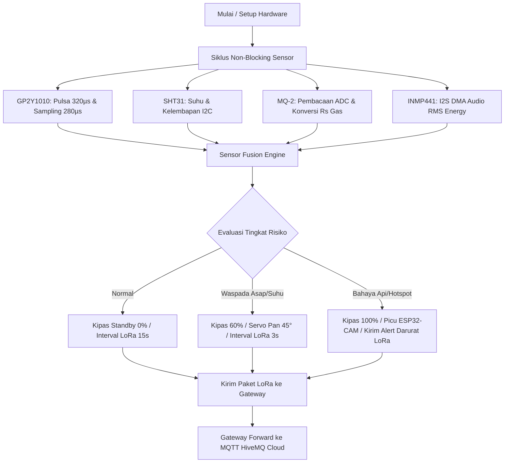

# Panduan Penggunaan Firmware Keseluruhan Sistem SiAGA Hutan (Forest Sentinel)

Dokumen ini merupakan panduan teknis operasional dan kompilasi untuk **tiga firmware terintegrasi** yang mengendalikan seluruh 9 modul perangkat keras, node visual, dan gateway telemetri sistem **SiAGA Hutan (Forest Acoustic Sentinel & Fire Guard)**.

---

## 1. Struktur Berkas Program

Direktori `Firmware_Keseluruhan_SiAGA_Hutan/` terdiri atas 3 subfolder sketch Arduino:

```
Firmware_Keseluruhan_SiAGA_Hutan/
├── SiAGA_Hutan_Master_Node/
│   └── SiAGA_Hutan_Master_Node.ino      <-- Firmware Utama Master Controller ESP32-S3 N16R8
├── SiAGA_Hutan_ESP32_CAM/
│   └── SiAGA_Hutan_ESP32_CAM.ino        <-- Firmware Visual Node ESP32-CAM AI-Thinker
├── SiAGA_Hutan_Gateway_MQTT/
│   └── SiAGA_Hutan_Gateway_MQTT.ino     <-- Firmware Gateway Radio LoRa -> WiFi/MQTT Bridge
└── README_PANDUAN_FIRMWARE.md           <-- Panduan Teknis & Instruksi Flashing
```

---

## 2. Matriks Alokasi Pinout & Peran Hardware

### A. Node Master Controller (ESP32-S3 DevKitC-1 N16R8)

| GPIO Pin | Sinyal / Bus | Modul Terhubung | Deskripsi Rangkaian |
|:---:|:---:|:---:|---|
| **GPIO 1** | ADC1_CH0 | **Sensor Gas MQ-2** | Masukan analog melalui pembagi tegangan $10\,\text{k}\Omega / 20\,\text{k}\Omega$ + Kapasitor $100\,\text{nF}$ |
| **GPIO 2** | ADC1_CH1 | **Sensor Debu Sharp GP2Y1010** | Masukan analog Vo melalui pembagi tegangan $4.7\,\text{k}\Omega / 10\,\text{k}\Omega$ (*tanpa kapasitor*) |
| **GPIO 4** | I2C SDA | **Sensor SHT31** | Jalur data I2C (Pull-up $4.7\,\text{k}\Omega$ ke 3.3V) |
| **GPIO 5** | I2C SCL | **Sensor SHT31** | Jalur clock I2C (Pull-up $4.7\,\text{k}\Omega$ ke 3.3V) |
| **GPIO 14** | Digital Out | **GP2Y1010 Pin 3 (LED)** | Pulsa pemicu IRED ($320\,\mu\text{s}$ aktif LOW, cuplik ADC di $280\,\mu\text{s}$) |
| **GPIO 15** | PWM Out | **Driver Kipas DC 5V** | PWM MOSFET (AO3400A / IRLZ44N) untuk sampling udara aktif |
| **GPIO 17** | UART2 TX | **ESP32-CAM U0RXD** | Mengirim sinyal pemicu jepretan foto visual |
| **GPIO 18** | UART2 RX | **ESP32-CAM U0TXD** | Menerima status dan konfirmasi ukuran berkas gambar |
| **GPIO 21** | UART1 RX | **LoRa E220 TXD** | Menerima data telemetri/konfigurasi dari radio LoRa |
| **GPIO 38** | Digital In | **LoRa E220 AUX** | Indikator status buffer E220 (LOW = Sibuk, HIGH = Siap) |
| **GPIO 39** | I2S SCK | **Mikrofon INMP441** | Bit Clock I2S DMA ($16\,\text{kHz}$, 32-bit mono) |
| **GPIO 40** | I2S WS | **Mikrofon INMP441** | Word Select / LRCLK I2S |
| **GPIO 41** | I2S SD | **Mikrofon INMP441** | Serial Data Audio INMP441 langsung ke buffer DMA |
| **GPIO 42** | PWM Out | **Servo SG90** | Pulsa kendali $50\,\text{Hz}$ untuk pan kamera pemantau ($0^\circ - 180^\circ$) |
| **GPIO 47** | UART1 TX | **LoRa E220 RXD** | Mengirim paket telemetri LoRa ke gateway |

---

## 3. Kebutuhan Library Arduino IDE

Pastikan telah menginstal library berikut melalui **Library Manager** di Arduino IDE (`Ctrl + Shift + I`):

1. **`Adafruit SHT31 Library`** (oleh Adafruit) — untuk pembacaan suhu dan kelembapan I2C.
2. **`ESP32Servo`** (oleh Kevin Harrington / John K. Bennett) — untuk penggerak servo SG90 berbasis timer ESP32.
3. **`PubSubClient`** (oleh Nick O'Leary) — untuk protokol MQTT pada Gateway.
4. **`esp32` board package** (oleh Espressif Systems versi $\ge 2.0.14$ atau versi $3.x$).

---

## 4. Pengaturan Konfigurasi Board Arduino IDE

### A. Untuk Node Master (ESP32-S3):
- **Board**: `ESP32S3 Dev Module`
- **USB CDC On Boot**: `Enabled` (Penting untuk keluaran serial USB langsung)
- **CPU Frequency**: `240MHz (WiFi)`
- **Flash Size**: `16MB (128Mb)`
- **Flash Mode**: `QIO 80MHz`
- **Partition Scheme**: `16M Flash (3MB APP/9.9MB FATFS)` atau `Default 16MB`
- **PSRAM**: `OPI PSRAM`
- **Upload Mode**: `UART0 / Hardware CDC`

### B. Untuk Visual Node (ESP32-CAM):
- **Board**: `AI Thinker ESP32-CAM`
- **CPU Frequency**: `240MHz`
- **Flash Mode**: `QIO`
- **Partition Scheme**: `Huge APP (3MB No OTA/1MB SPIFFS)`

### C. Untuk Gateway:
- **Board**: `ESP32S3 Dev Module` atau `ESP32 Dev Module`
- **Flash Size**: `4MB` atau `16MB`

---

## 5. Alur Kerja Logika & Sensor Fusion Engine

Sistem bekerja secara **non-blocking** menggunakan mesin status (*state machine*) dan pewaktuan `micros()`/`millis()`:



### Format Paket Data LoRa (JSON Ringkas):
```json
{"seq":102,"t":32.5,"h":58.2,"d":0.045,"g":1.15,"rms":380,"risk":0,"fan":0,"srv":0}
```
* `seq` : Nomor urut paket
* `t`   : Suhu (°C)
* `h`   : Kelembapan (%RH)
* `d`   : Kepadatan partikel debu/asap optik ($mg/m^3$)
* `g`   : Tegangan sensor gas MQ-2 ($V$)
* `rms` : Rata-rata energi akustik mikrofon MEMS
* `risk`: Tingkat ancaman ($0 = \text{NORMAL}$, $1 = \text{WASPADA}$, $2 = \text{BAHAYA}$)
* `fan` : Status PWM kipas ($0 - 255$)
* `srv` : Sudut derajat servo pan ($0^\circ - 180^\circ$)

---

## 6. Protokol Downlink Perintah (Gateway -> Node)

Admin dapat mengontrol aktuator dari dashboard web/MQTT melalui topik `iot/siaga_hutan/command`. Format perintah yang didukung:

| Perintah String | Aksi pada Node Master |
|---|---|
| `SET_FAN:255` | Menyalakan kipas ke kecepatan penuh ($100\%$) untuk membersihkan debu/sampling intensif |
| `SET_FAN:0` | Mematikan kipas |
| `SET_SERVO:90` | Menggerakkan servo kamera ke sudut $90^\circ$ |
| `TRIGGER_CAM` | Memicu ESP32-CAM mengambil foto seketika |
| `PING` | Memeriksa liveness node (dibalas dengan paket `PONG`) |

---

## 7. Langkah Pengujian Bertahap (Bring-Up Guide)

1. **Uji Catu Daya Tanpa Beban**:
   - Ukur rel `+5V_POWER`, `+5V_CLEAN`, dan `+3.3V` dengan multimeter pastikan stabil di $5.0 \pm 0.1\,\text{V}$ dan $3.3 \pm 0.05\,\text{V}$.
2. **Flash ESP32-CAM**:
   - Unggah sketch `SiAGA_Hutan_ESP32_CAM.ino`. Buka Serial Monitor pada baud rate 115200 dan pastikan muncul log `PONG:CAM_READY`.
3. **Flash Node Master ESP32-S3**:
   - Unggah sketch `SiAGA_Hutan_Master_Node.ino`. Periksa respon SHT31, Sharp, MQ-2, dan INMP441 pada Serial Monitor.
4. **Flash Gateway & Koneksi MQTT**:
   - Masukkan SSID, Password Wi-Fi, serta kredensial broker HiveMQ Cloud pada `SiAGA_Hutan_Gateway_MQTT.ino`.
   - Unggah sketch, amati hingga gateway terhubung ke Wi-Fi dan MQTT broker.
5. **Uji Transmisi Telemetri Jarak Jauh**:
   - Pastikan antena $900\,\text{MHz}$ terpasang pada kedua modul E220.
   - Amati data yang terkirim dari Node diterima oleh Gateway dan dipublikasikan ke topik MQTT `iot/siaga_hutan/telemetry`.
